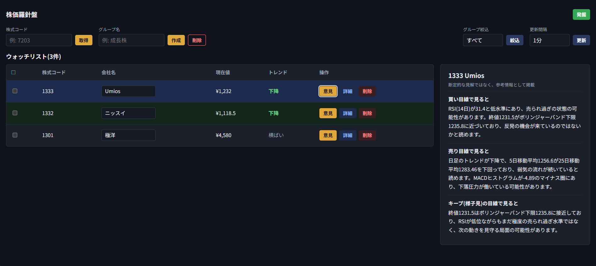
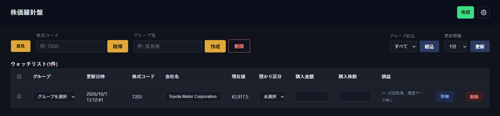
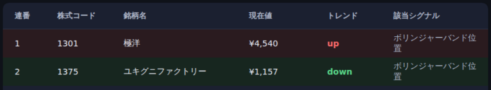
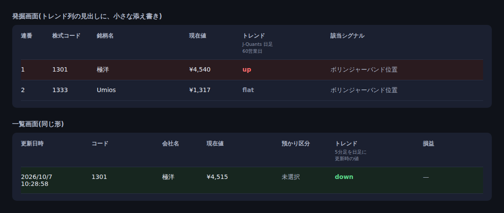

# doc-spec: トレンド判定・色の日本式統一・AIの3つの目線(エピック AIDDS-9)

## 追記の一覧

元の本文は、合意済みなので、書き換えない。追記が、あとの合意として、有効になる。

- AIDDS-10(2026-10-06): 保有銘柄のトレンドは、列`type_daily_trend`(数値。判定なしは0)になり、APIの項目名も`type_daily_trend`(文字)になる。本文の`daily_trend`(保有銘柄)は、この追記が有効。詳細は[10-trend-type-master.md](10-trend-type-master.md)
- AIDDS-10(差し戻し・仕様漏れ、2026-10-07): 保有一覧のトレンド列は、API の文字列(`none` / `up` / `down` / `flat`)を、そのまま表示する(上昇・下降・横ばいへの変換は、しない。判定なしは`none`)。本文の保有一覧の表示の記述は、この追記が有効。詳細は[10-trend-type-master.md](10-trend-type-master.md)
- AIDDS-17(2026-10-07): 発掘の一覧のトレンドは、保有一覧と同じく、種類マスタの名前(`up` / `down` / `flat` / `none`)を、そのまま表示する。APIの項目名は`type_daily_trend`になり、結果のページ分けは、フロントに移る。`none`の銘柄は、一覧に出さない(条件なしのときを除く)。本文の、発掘のトレンドの表示と、`ma_trend`のときの「—」の記述は、この追記が有効。詳細は、本書の末尾の節
- AIDDS-18(2026-10-07): 発掘と一覧の、トレンド列の見出しに、出どころの添え書きを付ける(発掘=「J-Quants 日足」「60営業日」、一覧=「5分足を日足に」「更新時の値」)。両画面で食い違い得る理由の説明を含む。詳細は、本書の末尾の節

Jira: AIDDS-9 機能改善 202610_01(AIDDS-5・AIDDS-6・AIDDS-7・AIDDS-8・AIDDS-11)。実装計画:
[docs/superpowers/plans/2026-10-01-AIDDS-9-feature-improvement-202610-01.md](../superpowers/plans/2026-10-01-AIDDS-9-feature-improvement-202610-01.md)
(Task 1〜4 が AIDDS-6・7・5・8。Task 5 が AIDDS-11。「意見」の画面と保存の作り直し)

## 機能概要

日足のトレンド(上昇・下降・横ばい)を判定して、保有銘柄の一覧と発掘の一覧に出す。
アプリ全体の色を、日本の証券会社(SBI証券)に合わせて、上昇・プラス・ポジティブを赤、
下落・マイナス・ネガティブを緑に揃える。保有銘柄の一覧には、各行に「意見」ボタンを置き、押すと一覧の右側のパネルに、
その銘柄のAIによる3つの目線(買い・売り・キープ)を出す。作った意見は、`trend`の行に保存する。

## 実装背景

- 売り(利益確定・損切り)の判断は難しく、自己バイアスがかかりやすい。機械的に判定した
  トレンドと、第三者の意見としてのAIの読み方を並べて、自分の判断の偏りを取り除く
- 空売りは行わない。下降は、空売りの候補を探すためではなく、売りの判断と、買わない判断の
  材料として使う。現物の買いだけなら、損失の上限は購入額に収まる
- 今のアプリは、ローソク足・損益・ニュースが、上昇・プラス・ポジティブ=緑、
  下落・マイナス・ネガティブ=赤(西洋式)。日本の証券会社の画面と色の意味が逆で、
  売りの判断で色を読み間違えるおそれがある

## 影響・対象範囲

- 対象:
  - トレンドの判定(新規モジュール)と、判定の設定の外出し(環境変数)
  - 保有銘柄の一覧: `trend`テーブルに列`daily_trend`を追加。「トレンド」列と行の色
  - 発掘の一覧: 「トレンド」列と行の色
  - アプリ全体の色の日本式への統一(ローソク足・損益・ニュースのセンチメント・トレンドの行)
  - 保有銘柄の一覧の各行に、「意見」ボタンを置き、右側に、AIによる3つの目線のパネルを出す(押したときだけ)。
    作った意見は、`trend`の新しい列`perspectives`に保存する(AIDDS-11)
- 対象外:
  - 空売り向けの機能
  - 発掘の絞り込み条件`ma_trend`の変更(判定の定義は変えない)
  - 詳細画面へのトレンドの表示(一覧で確認するため)
  - 発掘・詳細の画面でのAIの意見(廃止。一覧の「意見」ボタンだけにする)
  - 意見の「作り直し」の操作(「更新」で新しい`trend`の行ができるまで、保存済みを使い続ける)
  - 矢印による表示(文字と色のみ)

## ゴール

- トレンドは、上昇(`up`)・下降(`down`)・横ばい(`flat`)の3つ。日足が26本未満など、
  判定できないときは、値を持たず(`null`)、画面には「—」と出す
- 判定の期間と閾値は、コードに直書きせず、環境変数で設定できる
- 保有銘柄のトレンドは、取得・更新のときに計算して保存する。一覧の表示のたびに、
  重い`detail`を読み直して計算することはしない
- 発掘の一覧のトレンドは、表示のとき、保存済みの日足から計算する
- 発掘で`ma_trend`を条件にした結果は、判定が「上昇」でない銘柄に、トレンドを出さない
  (「—」。絞り込みが「上昇」と判断した銘柄に、「横ばい」と出る食い違いを避ける)
- 上昇・プラス・ポジティブ=赤、下落・マイナス・ネガティブ=緑。削除ボタンとエラー文の赤は
  そのまま
- AIの3つの目線は、入力に無い数字・事実を書かず、断定しない。検査を通らない出力は
  捨てて、「取得できていません」と出す

## 解決策・技術アーキテクチャ

### トレンドの判定

`backend/app/trend_direction.py`の`classify_trend(closes)`。終値の並びから、短期平均
(既定5日)・長期平均(既定25日)・長期平均に対する差(%)を求める。

- 差の絶対値が閾値(既定1.0%)以内なら、横ばい
- 短期平均が長期平均より上で、短期平均が前日より上向きなら、上昇
- 短期平均が長期平均より下で、短期平均が前日より下向きなら、下降
- 上のどれでもなければ、横ばい
- 終値が「長期の期間+1」本に満たない、または長期平均が0のときは、判定なし(`null`)

yfinanceの日足(キー`close`)と、J-Quantsの日足(キー`c`)の両方から、同じ関数で判定する。

**設定(環境変数)**

- `TREND_SHORT_PERIOD`(既定5)、`TREND_LONG_PERIOD`(既定25)、`TREND_FLAT_BAND_PCT`(既定1.0)
- `.env` / `.env.example` / `docker-compose.yml`に追加する(既存の`JQUANTS_*`と同じ方式)
- 不正な値(数値でない、短期が1未満、長期が短期以下、閾値が負)は、バックエンドの
  起動時にエラーにする
- 値を変えたときの反映: 発掘の一覧は、表示のたびに計算するので、すぐ変わる。保有銘柄は、
  取得・更新のときに保存するので、次の更新から変わる
- 発掘の絞り込み条件`ma_trend`の期間(5日・25日)は、条件JSON(07)の値で、この設定とは
  別。`ma_trend`には、閾値が無い

### DBスキーマ

**`trend`テーブル(既存)に列を追加**

- `daily_trend` (String(8), NULL許容。値は`up` / `down` / `flat`、判定できないときはNULL)

テーブルは増やさない。マイグレーションは無く、反映にはDBの作り直し(`docker compose down -v`)
が要る。既存の行は、次の更新まで、NULL(画面では「—」)。

### 画面

- 保有銘柄の一覧: 「購入株数」の右(「損益」の左)に「トレンド」列。行の色は、上昇=赤っぽい、下降=緑っぽい。
  横ばいと「—」は、色なし
- 発掘の一覧: 同じく「現在値」の右に「トレンド」列と行の色。選択中の行の強調は、
  緑から青系に変える(下降の行の緑と見分けるため)
- 表示は、文字(上昇 / 下降 / 横ばい)と色。部品は`TrendBadge`、行のクラスは
  `row-trend-up` / `row-trend-down`

### 色の統一

- 新しいCSS変数: `--up-bg` / `--up-text`(赤系)、`--down-bg` / `--down-text`(緑系)、
  `--row-up-bg` / `--row-down-bg`(行の薄い色)
- ローソク足の`--candle-up`は赤、`--candle-down`は緑に入れ替える。損益の`pnl-plus`は赤、
  `pnl-minus`は緑。ニュースの`news-pill-positive`は赤、`news-pill-negative`は緑
- `--pill-red-*` / `--pill-green-*`は、削除ボタン・エラー文などのために残す(入れ替えない)
- MACDの線は、今の色のまま。専用の変数`--macd-signal` / `--macd-histogram`に分ける

### AIの3つの目線

保有銘柄の一覧の行の「意見」ボタンを押したときだけ、その行の銘柄について作る(保存済みなら作らない)。
取得・更新のときには作らない(トークンの消費を、押した銘柄の数に抑える)。

**画面**(AIDDS-11で作り直した。画面イメージ:
[AIDDS-11-opinion-panel-mock.png](../images/AIDDS-11-opinion-panel-mock.png))

- 保有銘柄の一覧の各行の最後の列に、「意見 / 詳細 / 削除」の3つのボタンを並べる(列の見出しは「操作」)。
  「意見」は黄色(`btn-primary`。取得・作成と同じ、ユーザーが行う操作の色)。一覧の左上の「意見」ボタンと、
  表の下のパネルは、廃止する
- 「意見」を押すと、一覧の右側にパネルを出す(幅は、一覧と並べたとき、画面幅の約43%。文字は、読みやすいよう、本文16px・見出し20px)。見出しは「{コード} {銘柄名}」。
  「断定的な見解ではなく、参考情報として掲載」の注記つき。パネルには、閉じるボタンを置かない。
  同じ行の「意見」をもう一度押すと閉じる。別の行の「意見」を押すと、パネルがその銘柄に切り替わる。
  開いている行は、行の色を青系にして示し、「意見」ボタンは押された状態(`aria-pressed`)にする
- パネルを開いている間、一覧は、主要な列だけ残して折りたたむ。残す列: チェック・コード・会社名・
  現在値・トレンド・操作。隠す列: グループ・更新日時・預かり区分・購入金額・購入株数・損益。閉じると元に戻る。
  折りたたんでいる間、行のエラー文(保存の失敗など)は、会社名の下に出す
- パネルの開閉で、行と一覧の縦幅が変わらないようにする(行の高さを固定する)
- 画面幅が約1100px未満のときは、パネルを一覧の下に出す(折りたたまない)
- 作成中は、パネルに「作成中...」を出す。失敗したときは、失敗の文言を出し、他の銘柄には影響させない。
  失敗した意見は保存しない。パネルを閉じて開き直す(または別の行を経由する)と、もう一度作る
- 意見は、押した行(`trend`の行)に保存する。保存済みの行で「意見」を押すと、AIを呼ばず、保存済みを、
  作成日時を添えて出す。「作り直す」ボタンは置かない。「更新」で新しい`trend`の行ができると、意見は
  空に戻る(その行で「意見」を押したときに、作る)。パネルを開いたまま「更新」したときは、行が
  差し替わるので、パネルを閉じる(「更新」では、AIを呼ばない)
- 目的: 同じ判断データで、都度トークンを消費しない。取得・更新のときには作らない
- 1回の操作で作るのは、1銘柄。チェックボックスは、意見には使わない

**入力と出力**

- 入力: 日足から計算した数字(終値、5日・25日移動平均とその差、RSI、MACDヒストグラム、
  ボリンジャーバンド上限・下限、取得できた期間の高値・安値(出来高の比率は、最終足が途中の場合に誤解を招くため含めない)、トレンド)。
  桁区切りなし・小数2桁まで(末尾の0は省く)の文字列で渡し、そのまま引用させる
- 出力: `{"buy": ..., "sell": ..., "keep": ...}`の3つ。「買い目線で見ると」「売り目線で見ると」
  「キープ(様子見)の目線で見ると」の、数字がどう読めるかだけを、各2文以内で書く。買う・売るを
  勧めない。控えめな言い方にする。標準語で書く
- 検査(捏造しない): 入力に無い数字を含む、数字が1つも無い、断定の語(必ず・絶対・確実・
  間違いない・べきです・しましょう・してください)を含む、入力に無い事柄(決算・業績・材料・
  ニュース・配当・増益・減益・報道)に触れる、のどれかなら、その出力を捨てる
- 日足が26本未満のときは、AIを呼ばない

**API**

- `POST /trends/{code}/perspectives`: 200 `{"buy", "sell", "keep", "created_at"}`。保存済みなら、AIを
  呼ばず、保存済みを返す。無ければ、作って保存して返す。404(その銘柄が無い)、422(日足が足りない)、
  502(生成に失敗した、または検査に通らなかった。文言は「AIの読み方は今のところ取得できていません」。
  保存しない)
- 保存先: `trend.perspectives`(JSON。NULL可。`{"buy", "sell", "keep", "created_at"}`)。既存の`opinion`列
  (前回取得比の所見)とは別の列

### API

- `GET /trends`: 各項目に`daily_trend`(`up` / `down` / `flat` / `null`)と、`perspectives`
  (保存済みの意見。無ければ`null`)
- `GET /screening/results/{condition_id}`: 各項目に`daily_trend`。`ma_trend`が条件に含まれ、
  判定が`up`でないときは`null`
- `POST /trends/{code}/perspectives`: AIの3つの目線(上の「AIの3つの目線」を参照)

### エラー処理

- トレンドの判定に失敗しても(日足の欠損・不正な設定など)、銘柄の取得・更新は失敗させず、
  `daily_trend`をNULLにして、警告をログに出す
- AIの3つの目線の生成に失敗しても(API失敗・検査で不合格)、502を返すだけで、他の銘柄のカードや、
  銘柄の取得・更新には、影響させない

### テスト方針

- トレンドの判定: 上昇・下降・横ばい、閾値ちょうど、短期が上でも下向きのとき、日足不足、
  長期平均が0、設定の読み込みと不正値
- 保有銘柄: 取得・更新での保存、日足不足でNULL、一覧のAPI
- 発掘: `daily_trend`の返却、`ma_trend`条件のときの扱い
- 色: CSSの対応関係(損益・センチメント・トレンド・ローソク足・削除ボタン・エラー文)
- AI: 入力の整形、検査(数字・断定・入力に無い事柄)、JSON以外の応答、コードフェンス、
  日足不足のとき呼ばない、エンドポイントの状態コード(200・404・422・502)、取得・更新のときに
  作らない、保存(作ったら保存する・保存済みならAIを呼ばない・失敗したら保存しない・更新で新しい行は空)、
  行の「意見」ボタンでのパネルの開閉・切り替え、折りたたむ列、1銘柄の失敗が他に影響しない。
  テストでは、本物のClaudeを呼ばない
- 実機スモークテスト(`CLAUDE.md`)

## 今後の想定(未確定。この作業が終わったあとの変更)

トレンドの種類を、文字(`up` / `down` / `flat`)ではなく、種類テーブルの数値で持つ変更を
想定している。細部は、まだ決まっていない。

- 種類テーブル`trend_system_type`(新規)の案: `id`(auto increment)、`type_column`
  (どの列の種類か)、`type_name`、`type_value`
- `daily_trend`の種類(案): `0: none` / `1: up` / `2: down` / `3: flat`
- Jira: AIDDS-10(別のタスクにした。今回のDB作り直しには含めない)
- 決めること: `type_column`に入れる値、`trend.daily_trend`を数値の列に変えるか(その場合、
  「判定なし」はNULLでなく`0`)、APIと画面は文字のままにするか、種類テーブルをアプリが読んで
  使うか(参照用に留めるか)、今回のDB作り直しに含めるか

## 画像

- 「意見」の行ボタンと右側パネルの画面イメージ(AIDDS-11。案): 
  各行に「意見 / 詳細 / 削除」を並べ、「意見」を押した行の銘柄の3つの目線を、一覧の右側に出す。
  開いている間、一覧は主要な列だけにする。Jira の AIDDS-11 に、添付済み(2026-10-01)。
- 「意見」ボタンの位置の画面イメージ(AIDDS-8。AIDDS-11で置き換えた。経緯の記録として残す):
  

## 追記: AIDDS-17・AIDDS-18 発掘と一覧のトレンドの表示(2026-10-07)

Jira: AIDDS-17・AIDDS-18(親エピックは AIDDS-9。エピックは、グルーピング)。実装計画は、本書の冒頭の計画書(Task 7・8)。
元の本文は、書き換えない。この節が、あとの合意として、有効になる。

### AIDDS-17 発掘の一覧のトレンドを、種類マスタの名前で表示する

10の追記(AIDDS-10の差し戻し)で「別のタスクにする」とした、発掘の一覧の扱い。保有一覧と同じ形にそろえる。

- **表示**: 種類マスタ(`trend_system_type`)の名前(`type_name`)の文字列を、そのまま出す。`up` / `down` / `flat` / `none`。「上昇・下降・横ばい」への変換は、しない。
  発掘専用の日本語の対応表(`screeningTrendLabels.ts`)は、廃止する
- **保存しない**: 発掘のトレンドは、DBに列を足さない。表示のときに、保存済みの日足から判定し(従来どおり)、
  結果を数値(`none`=0、`up`=1、`down`=2、`flat`=3)に直し、マスタと結んで、名前を付ける。
  マスタに行が無いときは、`none`
- **APIの形**: `GET /screening/results/{condition_id}`
  - 各項目の`daily_trend`を廃止し、`type_daily_trend`(文字。`none` / `up` / `down` / `flat`)にする。
    保有一覧と同じ項目名にする(マスタの参照が同じため。`daily_trend`という名前にすると、マスタに、別の種類の列ができてしまう)
  - 判定できないとき(日足が足りないなど)は、`null`でなく、`none`
  - `ma_trend`が条件に含まれ、判定が「上昇」でない銘柄も、`none`(従来の`null`)
  - ページ分け(`page`・`page_size`)を廃止する。条件に合う全件を、トレンド付きで返す。
    レスポンスは、`condition_id` / `total`(返した件数) / `items`
- **画面の業務ルール(発掘画面だけ)**: `type_daily_trend`が`none`の銘柄は、一覧に出さない(行ごと除く)。
  ただし、シグナルの条件を1つも選んでいないとき(各項目の`matched_signals`が空)は、全銘柄が対象なので、
  除かず、トレンド欄に`none`と表示する。この制御は、フロントで行う(APIとマスタは、`none`を、そのまま扱う)
- **ページ分け(フロント)**: 全件から`none`を除いたあとで、1ページ20件に分けて表示する。
  例: 全体50件のうち`none`が20件なら、30件が残り、1ページ目は20件、2ページ目は10件。
  「該当{N}件」と、ページ数は、除いたあとの件数で数える。連番は、ページを跨いで続く
- **行の色**: 変えない(上昇=赤っぽい、下降=緑っぽい。SBI証券のアプリの色に合わせる)
- **変更する元の記述**:
  - 本書の「ゴール」: 「発掘の一覧のトレンドは、表示のとき、保存済みの日足から計算する」(計算は、同じ。出力は、マスタの名前になる)。
    「発掘で`ma_trend`を条件にした結果は、判定が「上昇」でない銘柄に、トレンドを出さない(「—」)」
    (その銘柄は、`none`を返し、画面は、条件ありのとき、一覧から除く)
  - 本書の「画面」: 発掘の一覧の「表示は、文字(上昇 / 下降 / 横ばい)」(`up` / `down` / `flat`)
  - 07の結果API: 「ページング付きで返す」(全件を返す)、「各項目に`daily_trend`(`up` / `down` / `flat` / `null`)」(`type_daily_trend`)、
    結果エリアの「ページング」(フロントでのページ分け)
  - 10の追記: 「発掘の一覧は、別のタスクにする。当面は、いまの表示(上昇・下降・横ばい・「—」)のまま」(このタスクで、そろえる)
- **受け入れの画面イメージ**: 発掘の一覧のトレンド列が、保有一覧と同様に、`up`や`down`などで出る。
  
  (Jira の AIDDS-17 に、添付済み。銘柄の値は、イメージ用)

### AIDDS-18 発掘と一覧のトレンドの注記

同じ銘柄で、発掘は「up」、一覧は「down」のように、食い違うことがある。判定の式は同じだが、入力のデータが違うため。
計算しているデータ自体が違う。

| | 発掘 | 一覧 |
|---|---|---|
| データ | J-Quants の日足の終値 | yfinance の5分足(直近60日分)を、日足にまとめた終値 |
| 値の時点 | 発掘のスキャンの時点で保存した日足から、表示のときに計算 | 銘柄の取得・更新のとき(値は、更新のたびに変わる) |

- **判定の式(共通)**: `classify_trend`(5日平均と25日平均の差。環境変数で設定)
- **添え書き**: 「トレンド」列の見出しに、小さな文字で、2行の添え書きを付ける。常に表示する
  - 発掘: 「J-Quants 日足」「60営業日」
  - 一覧: 「5分足を日足に」「更新時の値」
  - 範囲の表記は「60」に固定する。実際は、90営業日分を取得する場合がある。判定に使うのは、直近26本の終値だけで、範囲の長さは、結果に影響しない(説明には、入れない)
- **表示の条件**:
  - 見出しの高さは、3行以内(見出し1行と、添え書き2行)
  - 列幅は、原則として変えない。添え書きのためにだけ、広げてよい(例外。やむを得ない場合。発掘の「トレンド」列は、07で80px)
  - 一覧で、意見のパネルを開いて列を折りたたんだとき(現在値・トレンド・操作のみ)は、添え書きを出さない
  - ライト・ダークの両方で、添え書きが読める文字色にする
  - 既存の表示(列の並び、トレンドの文字・色、行の色など)は、変えない
- **今回の範囲外**: ヘルプモードを追加し、オンのときだけ、添え書きを表示する案(今は、常に表示)。吹き出し(ⓘ)の案は、採らなかった
- **変更する元の記述**: 07の「トレンド80px」(添え書きのために、広げてよい)
- **画面イメージ**: 添え書きの位置と文言(値の表示は、AIDDS-17に従う)。
  
  (Jira の AIDDS-18 に、添付済み)
